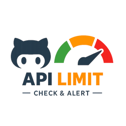

<p align="center">
  
</p>

# 📊 GitHub API Rate Limit Check

[](https://opensource.org/licenses/Apache-2.0)

## **Description**

This GitHub Action provides an **automated, real-time check** of your repository's GitHub API rate limits, giving you **instant visibility** into your API consumption. With detailed reporting and proactive alerts, you can **prevent unexpected disruptions** and **optimize API usage** in your workflows.

Designed for **reliability and clarity**, this composite action:

- Calls the **GitHub Rate Limit API** and extracts real-time usage metrics
- Formats and logs the results professionally in both **workflow logs** and **GitHub Step Summary**
- **Warns** when remaining API requests fall below a configurable threshold (default: `100`)
- **Fails fast** when limits are exhausted to avoid unexpected workflow failures
- **Handles missing data gracefully**, preventing false alarms from disabled or unavailable API endpoints

Whether you're running frequent automation, managing API-driven integrations, or monitoring GitHub resources, this action ensures you **stay informed and in control** of your API quota.

---

## 🚀 **Why Use This Action?**

✔️ **Prevents Workflow Failures** – Stops workflows from running when API limits are exceeded.  
✔️ **Proactive Warnings** – Get alerts when remaining requests drop below a safe threshold.  
✔️ **Clear, Professional Reporting** – View a **clean summary table** in GitHub Actions for quick insights.  
✔️ **Safe and Robust Handling** – Avoids errors due to missing or unavailable API data.  
✔️ **Simple Integration** – Plug it into any workflow with minimal setup.

---

## 📦 **Usage**

### **Workflow Example**

Add the following to your **GitHub Actions workflow** to monitor API usage before running rate-limited tasks.

```yaml
jobs:
  check-rate-limit:
    name: Check GitHub API Rate Limit
    runs-on: ubuntu-latest
    steps:
      - name: Checkout Repository
        id: checkout-repo
        uses: actions/checkout@v4

      - name: Run GitHub API Rate Limit Check
        id: check-rate-limit
        uses: coderrob/github-api-rate-limit-check@main
        with:
          github-token: ${{ github.token }}
          warning-threshold: 50  # Optional: warn when remaining calls drop below 50
```

---

## 📜 **How It Works**

1. **Fetches Rate Limit Data** → Calls the `https://api.github.com/rate_limit` endpoint.
2. **Parses and Processes Data** → Extracts core, GraphQL, and search API quotas.
3. **Logs Results** → Displays a structured **table** in `GITHUB_STEP_SUMMARY` and console logs.
4. **Triggers Alerts**:
   - **Warning** (`⚠️`) if remaining API requests **drop below the configured threshold** (default: 100).
   - **Error** (`❌`) if limits are **fully exhausted** (only if that API type is enabled).
5. **Fails the Workflow (if needed)** → Prevents unintended execution when API access is unavailable.

---

## 📊 **Example Output**

### **Console Logs**

```bash
GitHub API Rate Limit Status:
--------------------------------------------
 Core API:  85 / 5000  (Resets at 2026-01-29 15:00:00 UTC)
 GraphQL:   4500 / 5000  (Resets at 2026-01-29 15:00:00 UTC)
 Search:    0 / 30  (Resets at 2026-01-29 15:00:00 UTC)
--------------------------------------------
⚠️ GitHub API Rate Limit is low (85 remaining)!
❌ GitHub Search API Rate Limit has been fully exhausted!
```

---

### 📊 **GitHub API Rate Limit Summary**

| API Type     | Remaining | Limit | Reset Time (UTC)    |
| ------------ | --------- | ----- | ------------------- |
| **Core API** | **85**    | 5000  | 2026-01-29 15:00:00 |
| **GraphQL**  | **4500**  | 5000  | 2026-01-29 15:00:00 |
| **Search**   | **0**     | 30    | 2026-01-29 15:00:00 |

⚠️ **Warning:** GitHub API rate limit is low (85 remaining).  
❌ **Error:** GitHub Search API rate limit has been fully exhausted.

⏳ API limits reset hourly. Plan requests accordingly.

---

## 🛠 **Inputs**

| Name | Required | Default | Description |
| ---- | -------- | ------- | ----------- |
| `github-token` | Yes | - | GitHub token used for authentication (`${{ github.token }}`) |
| `warning-threshold` | No | `100` | Warning threshold for remaining API calls before issuing alerts |

---

## 🎯 **Best Use Cases**

- **Before running API-heavy workflows** (e.g., fetching issue data, triggering GitHub Actions via API).
- **Monitoring CI/CD jobs that rely on GitHub API calls** to avoid failures mid-run.
- **Logging and auditing API usage** across your organization’s GitHub actions.

---

## 🏆 **Take Control of Your GitHub API Usage**

This action gives you the **power to monitor, manage, and prevent API failures before they happen**. Whether you're a solo developer or running large-scale automation, **stay ahead of rate limits and keep your workflows running smoothly**. 🚀

---

### **🔗 Related Resources**

- [GitHub API Rate Limits Docs](https://docs.github.com/en/rest/rate-limit)
- [GitHub Actions Documentation](https://docs.github.com/en/actions)

---

## 🧪 **Testing**

This action includes comprehensive tests to ensure reliability:

- **Unit Tests**: Validate core functions with mock data
- **Integration Tests**: Verify end-to-end functionality in CI
- **Linting**: ShellCheck for script quality

Tests run automatically on pushes and pull requests via the [CI workflow](.github/workflows/ci.yml). See [`__tests__/`](../__tests__/) for details.
